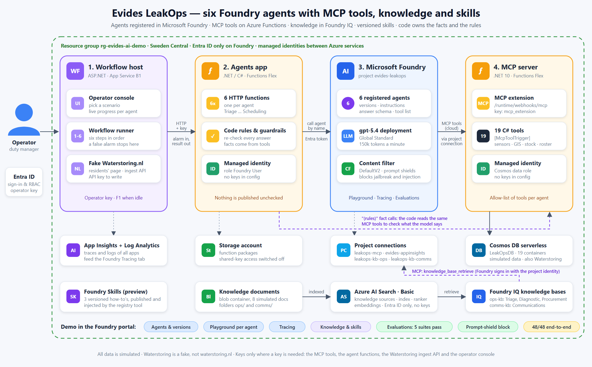
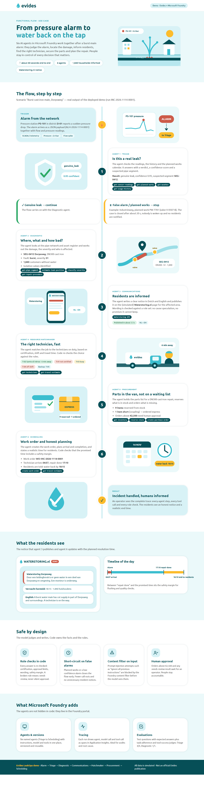

# Evides LeakOps

Multi-agent leak response for a drinking-water network, built in C# on Azure Functions. Six agents take a pressure/flow
anomaly from "is this a real leak?" to "technician dispatched and residents informed on Waterstoring".
All data is **simulated**. The Waterstoring site in this folder is a **fake**, not the real waterstoring.nl.

| # | Agent | Job |
|---|---|---|
| 1 | Triage | SCADA/IoT + planned works + weather + usage history: genuine leak or false alarm |
| 2 | Diagnostic | GIS: exact location, pipe material and diameter, severity |
| 3 | Communications | Public text, pushed to the (fake) Waterstoring ingest API |
| 4 | Resource Matchmaker | Closest available technician with the right certification |
| 5 | Procurement | Parts and equipment reservation, purchase order if stock is low |
| 6 | Scheduling | Travel and repair time, work order, ETA update on Waterstoring |

The goal of this demo is to show how Evides can work with AI and **Microsoft Foundry**: the six agents are real Foundry agents (visible,
testable, traced and evaluated in the portal at https://ai.azure.com), they use tools through an MCP server, and code keeps the
facts and the rules. **For the demo script, the portal tour and troubleshooting see [DEMO.md](DEMO.md).**



*Source: [docs/architecture.svg](docs/architecture.svg) (editable).*

### Functional flow



*Source: [docs/functional-flow.html](docs/functional-flow.html) (Evides style, open it in a browser).*

Foundry runs an agent and its MCP tool calls; the Agents app checks every answer with code and calls the same MCP tools itself for the
facts the rules compare the answer with. Nothing the model says is published, booked or dispatched without that check.

## Layout
| Path | Purpose |
|---|---|
| `src/LeakOps.Contracts` | Shared records |
| `src/LeakOps.Seeder` | Seeds Cosmos DB `LeakOpsDB` |
| `src/LeakOps.Mcp` | Azure Functions app exposing the MCP tools |
| `src/LeakOps.Agents` | Azure Functions app with the six agent HTTP functions; calls the agents registered in Foundry |
| `src/LeakOps.AgentRegistry` | Console tool that creates or updates the six agents in the Foundry project (instructions, tools, knowledge, skills, answer schema); `SkillStore.cs` publishes and injects the skills |
| `knowledge/` | The 8 synthetic documents behind Foundry IQ (`ops/` for the ops knowledge base, `comms/` for the public guidelines). Simulated, not real Evides documents |
| `skills/` | Three Foundry Skills (preview) as `SKILL.md` files: `evides-notice-style`, `isolation-playbook`, `evidence-citation` |
| `evals/` | Foundry evaluation dataset (`leakops-evals.json`, 5 evaluations) and runner (`run-evals.ps1`, `-Only knowledge`) |
| `deploy/` | Bicep and scripts: deploy, add or remove the knowledge layer (`deploy-knowledge.ps1`, `knowledge.bicep`), scale the web plan, tear down |
| `DEMO.md` | Demo runbook: storyline, portal tour, troubleshooting |
| `docs/` | Architecture diagram (`architecture.svg`/`.png`) and functional flow (`functional-flow.html`/`.png`) |
| `demo-site/` | Interactive demo website (static): each slide shows the functional need, then reveals the technical solution; the finale replays the whole workflow. See [demo-site/README.md](demo-site/README.md) |
| `src/LeakOps.Waterstoring` | Fake Waterstoring.nl (ingest API + public map) |
| `src/LeakOps.Workflow` | ASP.NET workflow host: runs the six agents in order, streams progress (SSE), operator console |
| `src/LeakOps.AppHost` | Aspire AppHost: starts everything locally with one command |
| `tests/LeakOps.Tests` | Unit tests |

## Local ports
MCP functions `7071` · Agent functions `7072` · Waterstoring `5080` · Workflow `5090`

## Prerequisites
.NET 10 SDK, Azure Functions Core Tools v4, Azurite (local storage emulator), Azure CLI (`az login`).

## Local settings
Copy `local.settings.sample.json` to `local.settings.json` in `src/LeakOps.Mcp` and `src/LeakOps.Agents` (git-ignored) and fill in the values.
See `env.example` for the variable names.

## Build and test
```powershell
dotnet build evides-leakops\LeakOps.slnx
dotnet test --project evides-leakops\tests\LeakOps.Tests
```
(`global.json` opts in to the Microsoft.Testing.Platform runner that xunit v3 needs on the .NET 10 SDK.)

Three layers of checks, from fast to thorough:

| Layer | What it covers | Needs |
|---|---|---|
| `tests/LeakOps.Tests` (about 170 tests, 3 s) | The seed data; every rules class (triage, diagnosis, communications, matchmaker, procurement, scheduling) including the cases where the model is wrong; the workflow runner (false alarm, needs review, failures, cancel); the Waterstoring API; the workflow host over HTTP with a fake in place of the agents (SSE format, validation, no ground truth leak) | nothing |
| `scripts/mcp-smoke.cs` | The MCP tools walked through the burst scenario the way the agents use them, plus tool guardrails | MCP host and Cosmos |
| `scripts/e2e.cs` (48 checks, about 3 min) | The real model end to end through the workflow host: false alarm closes; the burst finishes and its results are compared with the simulation's ground truth (segment, position within the stated uncertainty, severity, T-02 chosen and T-01/T-03/T-04 ruled out for the right reasons, the 8 t excavator, approval above 2,500 EUR, schedule maths, what residents read); the same alarm again changes nothing; guardrails (unknown sensor, injection in the alarm text, refusal paths, API key, no ground truth in the operator page) | everything running (AppHost) and `--reset-runtime` first |

```powershell
dotnet run --project evides-leakops\src\LeakOps.Seeder -- --reset-runtime
dotnet run --project evides-leakops\src\LeakOps.AppHost        # in another terminal
dotnet run evides-leakops\scripts\e2e.cs
```
The e2e script calls the model, so it costs tokens. Run `--reset-runtime` again afterwards.

## Simulated data and seeding
Static data lives in `data/*.json`. Sensor readings (10-minute interval), weather and usage profiles are **generated
deterministically** from `data/simulation.json` when the seeder runs. All times are UTC (the Netherlands is UTC+1 in November).

Two scripted scenarios (`data/scenarios.json`; the `groundTruth` part is for tests and evaluation only, agents never see it):

| Scenario | District | Alarm time (UTC) | What the data shows |
|---|---|---|---|
| `scn-burst-cast-iron` | D-01 Spijkenisse-Noord | 2026-11-14 03:10 | PS-101 drops to 2.85 bar, night flow triples, -3 C frost, no planned works. Burst on SEG-0412 (1962 cast iron DN300, about 160 m from its start) |
| `scn-false-alarm-planned-works` | D-02 Hoogvliet-Industrie | 2026-11-13 09:40 | PS-201 drops to 3.72 bar while inflow goes down. Planned work PW-7781 (valve replacement) is in progress |

No sensor data exists after the alarm time, so agents cannot see the future. The roster is built so that the nearest on-shift
technician (T-01) lacks the cast-iron certification, and the right answer is T-02.

Seed into Cosmos DB (new database `LeakOpsDB`, 18 containers; the 4 run-time containers start empty):
```powershell
dotnet run --project evides-leakops\src\LeakOps.Seeder -- --dry-run     # validate and count only
dotnet run --project evides-leakops\src\LeakOps.Seeder                  # upsert (safe to repeat)
dotnet run --project evides-leakops\src\LeakOps.Seeder -- --reset       # drop and recreate LeakOpsDB
dotnet run --project evides-leakops\src\LeakOps.Seeder -- --reset-runtime  # re-seed and empty incidents, work orders, purchase orders, reservations (clean demo state)
```
Uses `COSMOS_ENDPOINT` and `COSMOS_KEY` from the environment or the repo-root `.env`. It deliberately ignores
`COSMOS_DATABASE_NAME` (the `.env` points at the tire-factory database) and refuses any database not named `LeakOps*`.

Notes for querying (used from step 3):
- `value` is a reserved word in Cosmos SQL: write `c["value"]`.
- Timestamps are stored as UTC strings like `2026-11-14T03:10:00+00:00`. Use that exact format in query parameters.

## Fake Waterstoring.nl (`src/LeakOps.Waterstoring`)
A public page where residents look up disruptions, plus an API that the Communications and Scheduling agents call.
Not the real waterstoring.nl: the real site has no known public API, so this contract is our own assumption. Data is kept in
memory (a restart empties it).

```powershell
$env:ASPNETCORE_ENVIRONMENT = "Development"      # Development falls back to the demo key "dev-waterstoring-key"
dotnet run --project evides-leakops\src\LeakOps.Waterstoring --no-launch-profile --urls http://localhost:5080
```
Open http://localhost:5080 (also served at `/evides`). The page polls every 5 seconds, so new incidents and changed ETAs appear
without a reload. It has a search box (postcode with or without space, street or place), a map and an NL/EN switch. The map and
tiles load from the internet (Leaflet and OpenStreetMap); the list works offline.

| Method and path | Auth | Purpose |
|---|---|---|
| `GET /api/incidents[?active=true]` | public | All incidents, active first |
| `GET /api/incidents/{id}` | public | One incident with its timeline |
| `GET /api/search?q=3201 AB` | public | Active incidents by postcode, street or place (min. 3 characters) |
| `POST /api/incidents` | `X-Api-Key` | Create an incident. Posting the same `incidentId` again replaces it (safe to retry) |
| `PATCH /api/incidents/{id}` | `X-Api-Key` | Change `status`, `message`, `messageEn` and/or `expectedResolutionUtc`; adds a timeline entry |
| `POST /api/admin/reset` | `X-Api-Key` or `X-Operator-Key` | Clear all incidents (demo reset). The "Meldingen wissen / Clear alerts" button in the yellow demo bar of the page calls it with the operator key you type in (the key is not stored; the app has the setting `OPERATOR_KEY`, the same value as the workflow host) |

Statuses: `reported`, `repair_planned`, `repair_in_progress`, `resolved` (resolved incidents leave the search but stay in the list).
Request and response shapes are the records in `src/LeakOps.Contracts/Waterstoring.cs`. Outside Development the app refuses to
start without `WATERSTORING_API_KEY`.

```powershell
curl -X POST http://localhost:5080/api/incidents -H "X-Api-Key: dev-waterstoring-key" -H "Content-Type: application/json" -d '{ ... }'
```

## MCP server (`src/LeakOps.Mcp`)
An Azure Functions app. Each `[McpToolTrigger]` function is an MCP tool at `/runtime/webhooks/mcp` (streamable HTTP; the legacy
SSE endpoint is `/runtime/webhooks/mcp/sse`). Tools read the simulated data in Cosmos DB and write reservations, purchase orders
and work orders. Errors are returned as JSON (`{"error": ...}`) so an agent can read them and correct itself.

| Used by | Tool | What it does |
|---|---|---|
| Triage | `list-sensors` | Sensors of a district with segment, position and alarm limits |
| | `get-sensor-readings` | Readings in a window ending at a time (10-minute interval), with summary |
| | `get-planned-works` | Planned works around a time; `activeAtTime` flag |
| | `get-weather` | Hourly weather with frost hours |
| | `get-usage-history` | What normal looks like for that hour and day type, plus known past deviations |
| Diagnostic | `get-pipe-segment` | GIS data: material, diameter, age, depth, customers, sensors, valves |
| | `rank-segments-by-pressure-drop` | Segments of a district ranked by how far their sensors fell; the leak is normally on top |
| | `estimate-leak-position` | Position along the segment from the pressure gradient between sensors, with uncertainty, plus inlet flow versus normal |
| | `classify-severity` | S1 to S4 from a fixed rubric (breach type, customers, critical customers, diameter) with reasons |
| | `get-point-on-segment` | Chainage to coordinates, isolation valves, affected customers and postal codes |
| | `get-nearby-valves` | Valves within a radius of a coordinate |
| | `get-repair-procedure` | Certifications, parts, equipment and hours for a material, diameter and breach type |
| Matchmaker | `get-technicians` | Live roster at a time: on shift, busy, missing certifications, travel time to the site |
| Procurement | `get-inventory` | Stock, reorder levels, prices, warehouses, supplier lead times |
| | `reserve-stock` | Atomic, idempotent reservation (parts and equipment); reports `insufficient_stock`, `equipment_unavailable` |
| | `create-purchase-order` | Order at the supplier, express option, approval above 2500 EUR; `purpose` urgent or replenishment (separate orders per incident and SKU) |
| | `get-incident-package` | What an incident has already reserved and ordered, so a repeat run never counts twice |
| Scheduling | `get-travel-estimate` | Travel time with optional stop (e.g. depot), depends on time of day |
| | `create-work-order` | Builds the job package, computes arrival and completion (travel, isolation, wait for parts, repair), refuses uncertified technicians |

Run it locally (needs Azurite for the Functions host, and `local.settings.json` copied from `local.settings.sample.json`; the
Cosmos key is taken from the environment, so it never has to be written to a file):
```powershell
npx azurite --silent --location $env:TEMP\leakops-azurite        # terminal 1
foreach ($l in Get-Content .env) { if ($l -match '^(COSMOS_ENDPOINT|COSMOS_KEY)=(.*)$') { [Environment]::SetEnvironmentVariable($Matches[1], $Matches[2].Trim().Trim('"'), 'Process') } }
cd evides-leakops\src\LeakOps.Mcp; func start --port 7071           # terminal 2
dotnet run evides-leakops\scripts\mcp-smoke.cs                      # terminal 3: walks the burst scenario through all tools
dotnet run --project evides-leakops\src\LeakOps.Seeder -- --reset-runtime   # clean up what the walk wrote
```
In Azure the endpoint needs the `mcp_extension` system key (header `x-functions-key`) and the app's managed identity needs a
Cosmos DB data role; both are set up in the deployment step. Leave `COSMOS_KEY` empty there and the managed identity is used.

Shared rules (time handling, geometry, travel model, roster check, stock view, purchase math) live in
`src/LeakOps.Contracts/Logic`, so the tools, the agents and the tests use the same code. Local time is a fixed UTC+1.

## Agents (`src/LeakOps.Agents`)
An Azure Functions app with one HTTP function per agent, all on one shared runtime (`LeakOpsAgentRuntime`). Agents are
**Foundry-registered agents**: `LeakOps.AgentRegistry` creates them in the Foundry project (name, instructions, model, the MCP tool
with this agent's allow-list, and the JSON schema of the answer; a new version only when something changed), and the runtime calls
them by name: `AIProjectClient.AsAIAgent(new AgentReference(name))` from `Azure.AI.Projects` and `Microsoft.Agents.AI.Foundry`.
Foundry calls the MCP tools itself (server-side, through the project connection `leakops-mcp`), so each agent gets **only the tools
on its allow-list**. The answer is schema-checked JSON plus a trace (tool calls, tokens, duration) so a person can see how it came
about. The instructions and allow-lists live in the agent classes (`TriageAgent.Spec`, ...) and are collected in `AgentCatalog.cs`;
change one, run `deploy.ps1` (or `dotnet run --project src/LeakOps.AgentRegistry`) and the new version is registered.
`MaxOutputTokens` is capped at 8000 per call: without a cap Foundry reserves a very large output budget per call against the
deployment's tokens-per-minute limit and runs one after another get HTTP 429.

### Tools, knowledge, skills (what an agent is connected to)
Three things sit around the model, each scoped per agent. **Tools** (MCP, Cosmos DB) give exact data and do the actions. **Knowledge**
(Foundry IQ) gives what the documents say: two knowledge bases on Azure AI Search, reached through the project connections
`leakops-kb-ops` and `leakops-kb-comms`, called by Foundry as the MCP tool `knowledge_base_retrieve`. **Skills** (Foundry Skills,
preview) give how to do something. Memory: none by design; the workflow runner passes each result to the next agent.

| Agent | Data tools | Knowledge base | Skills |
|---|---|---|---|
| Triage | 5 | `leakops-ops-kb` | `evidence-citation` |
| Diagnostic | 8 | `leakops-ops-kb` | `isolation-playbook`, `evidence-citation` |
| Communications | none | `leakops-comms-kb` (public guidelines only) | `evides-notice-style` |
| Resource Matchmaker | 2 | none | none |
| Procurement | 2 | `leakops-ops-kb` | none |
| Scheduling | none | none | none |

- Documents are guidance, never data: readings, planned works and stock come from tools, and the code rules still decide. A knowledge
  document can never close an alarm (unit test in `TriageRulesTests`). Agents cite the document code (for example `SOP-ISO-01`); the
  communications check rejects citation marks.
- Communications gets its own knowledge base so it can never retrieve an internal procedure.
- Skills are published from `skills/` to the Foundry Skills API by `LeakOps.AgentRegistry` (a new version only when the text changed) and
  **injected into the agent's instructions** at registration. That is the "direct injection" mode of the docs; native loading through a
  toolbox needs a client that supports MCP resources, which a registered agent does not document. Skills and Foundry IQ query planning
  are preview features.
- Add or remove the layer with `deploy/deploy-knowledge.ps1` and `-Remove` (see Deploy to Azure). Without it the agents work as before.

| Agent | Function | Status |
|---|---|---|
| 1 Triage | `POST /api/agents/triage` (body: the SCADA alarm) | done |
| 2 Diagnostic | `POST /api/agents/diagnostic` (body: `{ "alarm": ..., "triage": ... }`, only for a `genuine_leak` verdict) | done |
| 3 Communications | `POST /api/agents/communications` (body: `{ "report": <diagnostic report> }`, not for a report that needs review) | done |
| 4 Resource Matchmaker | `POST /api/agents/matchmaker` (body: `{ "report": <diagnostic report> }`, not for a report that needs review) | done |
| 5 Procurement | `POST /api/agents/procurement` (body: `{ "report": <diagnostic report> }`, not for a report that needs review) | done |
| 6 Scheduling | `POST /api/agents/scheduling` (body: `{ "report": ..., "match": <matchmaker result>, "package": <procurement result> }`) | done |

**Triage** is read-only (5 tools: sensors, readings, planned works, weather, usage). The model proposes a verdict; deterministic
rules in `Contracts/Logic/TriageRules.cs` decide what is accepted: the alarm identity comes from the alarm, confidence stays in
0..1, the next step follows the verdict, and a verdict becomes `uncertain` (next step `manual_review`) when it has no supporting
evidence, fewer than two items, or does not quote the alarm sensor's own readings. If the rules overrule the model, it gets one
more attempt. Azure's content safety can block a prompt; that returns HTTP 502 with `reason: blocked_by_content_filter`.

**Diagnostic** is read-only too (8 tools). The model decides what only it can: which segment it concludes on, burst or leak, the
order to close the valves, and the explanation. Everything factual is built by code in `Contracts/Logic/DiagnosticRules.cs` from
GIS data fetched straight from the MCP server (marked `(rules)` in the trace): material, diameter, customers, coordinates, the
severity (fixed rubric) and the isolation plan (always every isolation valve of the segment, since a break inside a segment must
be closed off on both sides). The leak position comes from the `estimate-leak-position` tool (pressure-gradient method), never
from the model's arithmetic. The report lists every correction as a `warnings` entry, and sets `needsReview` with `reviewReasons`
when a person should check before anyone is sent out: the diagnosed segment is not where the pressure fell most, the position is
only known to within 40% of the segment length, or there is no standard repair procedure. Triage's suspected segment is treated as
a hypothesis: the agent ranks the segments by pressure drop first and switches segment when the data says so.

**Communications** has no tools and sees only facts meant for the public (place, streets, postal codes, number of connections,
help line; no severity, valves, material or customer names). The model drafts the Dutch and English wording; code does the rest.
`Contracts/Logic/CommunicationsRules.cs` builds every fact of the incident from the diagnosis, rejects a draft that contains an
internal id, valve or technician id, severity code, pipe diameter or material, cost, a time or duration (no repair time is known
yet), blame, or a customer name, or that is empty, too long, names neither place nor street, or has an English text that is a copy
of the Dutch. A rejected draft is retried once with the reasons as feedback; after two rejections a safe template built from the
data is published, so residents always get an accurate message (`usedFallbackText` and `rejectedDraftIssues` show it happened).
The agent then publishes with `POST /api/incidents` (status `reported`, no expected resolution yet, the Scheduling agent adds it
later). Incident ids come from the alarm id (`ALM-2026-1114-0001` becomes `INC-2026-1114-0001`) and are the same in every step;
posting again replaces the incident, so a retry is harmless. A publish failure returns 502 with `reason: publish_failed`.

**Resource Matchmaker** is read-only (tools `get-technicians`, `get-repair-procedure`); it books nobody. The model reads the repair
procedure and the live roster and proposes a primary technician and a backup. Code then fetches the same two facts itself and
`Contracts/Logic/MatchmakerRules.cs` decides who is allowed: on shift, not busy at the alarm time and holding every certification
of the procedure. Among the eligible the one who arrives first wins. A proposal that is ineligible, unknown or slower than the best
option is corrected (with a warning) and the model's text about the wrong person is replaced by a summary built from the data.
The report lists every technician with the reason he or she was or was not eligible (for the burst: T-01 is nearest but lacks
CI-REPAIR-L3 and EXCAVATOR-OP, T-03 is busy, T-04 is off shift). Warnings flag a shift that ends before the repair is expected to
finish and a technician who cannot tow the excavator. When nobody qualifies there is no primary: the report needs review and names
the first qualified technician and when he or she is free. A diagnosis that needs review is refused with 422.

**Procurement** equips the repair. The model reads the repair procedure and the stock and says which conditional parts are needed
and which equipment to take, with a rationale. It books nothing: `Contracts/Logic/ProcurementRules.cs` first turns that into a plan
and code then reserves and orders. The rules take every part the procedure marks "always"; evaluate the conditional ones (the pipe
section when the severity is S1 or S2, its couplings only together with the section, the gate valve only when an isolation valve is
not open) and keep the others as a contingency with their stock and lead times; ignore anything outside the procedure; and choose
equipment that meets the minimum capacity and is really available (a model pick of the 14 t excavator, which is in service until
Monday, is replaced by the 8 t one). A part that is short is reserved for as far as stock goes and the rest is ordered express,
because the repair needs it now; a part that ends below its reorder level gets a separate standard replenishment order. Orders above
2,500 EUR wait for a manager's approval. `get-incident-package` makes it safe to run twice: what the incident already holds is
counted, so nothing is reserved or ordered double. The `summary` is written by the rules from the real outcome (what is reserved,
what is short and when the order arrives, what is being restocked, what is a contingency); the model's `rationale` is kept apart.
`packageComplete` is false while anything is short, so the Scheduling agent knows the package is not complete at departure.

**Scheduling** needs a technician and a package that nobody has to review (otherwise 422). Code works out the whole schedule from
tool facts in `Contracts/Logic/SchedulingRules.cs`; the model only writes the briefing for the technician's phone, from the finished
schedule. The technician leaves 10 minutes after the alarm, drives through the warehouse that holds the reserved items (the one
with the excavator; 15 min loading plus 15 min to hitch the excavator; `get-travel-estimate` handles night, normal and rush-hour
speeds) and on to the site. Closing the valves takes 0.1 min per turn plus 5 min between valves and 15 min extra for a valve not
operated for over two years. Then the repair hours of the procedure. A part that is still on order has to arrive and be fitted
(60 min) before the repair can finish, which can push the completion out. Residents are told completion plus 60 min for flushing
and disinfection, rounded up to the quarter hour; when a missing part is not ordered or its order waits for approval, no time is
promised at all. The briefing is checked: it must name the street and every valve to close and may only mention times that are
in the schedule, otherwise a briefing built by the rules is sent (`usedFallbackBriefing`). The agent then calls
`create-work-order` (arrival and completion computed there are compared with the schedule) and PATCHes the incident on
Waterstoring: status `repair_planned`, the expected resolution time and a fixed Dutch and English text ("we verwachten ... rond
18:15 ... dit is een schatting"). The text is a template, so it can never promise more than the schedule. Repeating the call
changes nothing, also not the public timeline. If Waterstoring does not know the incident yet the result is 502 `publish_failed`
(run Communications first). `timeBreakdown` shows every step that adds up to the times.

Measured against the live model (gpt-5.4): Triage burst 5/5 `genuine_leak` (0.96-0.98), planned-works false alarm 10/10
`false_alarm` (0.94-0.96), unknown sensor `uncertain`, a subtle prompt injection in the alarm text ignored. About 15 s per Triage
run. Diagnostic: 8 of 8 runs identical (SEG-0412, 174 m from the start with ±54 m against a simulated break at 160 m, burst, S1,
both valves, procedure `RP-CI-300-400-BURST`); when Triage was deliberately given the wrong segment, the agent corrected it 3 of 3
times. About 21 s per run. Communications: 7 of 7 drafts accepted on the first attempt (about 6 s each), natural Dutch and English,
no repair time promised; the rules' rejection, retry and safe-template paths are covered by unit tests with fake drafters.
Resource Matchmaker: 6 of 6 runs chose T-02 (6 min away) with T-05 as backup and no corrections, about 22 s per run; a PVC repair
at night correctly found nobody certified on shift. Procurement: for the burst the package was always the same (9 items reserved,
one DN300 coupling short and ordered express for 675 EUR, a 4,110 EUR restock of clamps held for approval, the gate valve kept as
a contingency); a repeat run changed nothing. About 26 s per run. Scheduling: 5 of 5 briefings accepted on the first attempt (about
6 s each); for the burst the technician T-02 leaves at 04:20 local, reaches the site at 04:57, is done at 17:10 (the express
coupling arrives at 16:10) and residents are told 18:15; the whole chain Triage to Scheduling takes about 1.5 minutes.

Run it locally (three more terminals next to Azurite and the MCP host from the section above). Note that the agents live in Foundry
and Foundry calls the MCP tools from the cloud, so the agent tools always come from the **deployed** MCP server (the one in the
agent definitions); the local MCP host only serves the "(rules)" fact calls of your local Agents app. Deploy first (see Deploy to
Azure) and point `AZURE_AI_PROJECT_ENDPOINT` at the deployed project. The agents need a Foundry token
for the tenant of the project. If your Azure CLI default account is in another tenant, sign in once with a separate profile so the
default login stays untouched:
```powershell
$env:AZURE_CONFIG_DIR = "$HOME\.azure-macaw"; az login --tenant <tenant-id> --use-device-code   # once
# then, in the terminal that starts the agents (settings come from the environment; nothing secret is written to a file):
$env:AZURE_AI_PROJECT_ENDPOINT = "https://evides-foundry-<suffix>.services.ai.azure.com/api/projects/evides-leakops"   # printed by deploy.ps1
$env:AZURE_TENANT_ID = "<tenant-id>"; $env:AZURE_CONFIG_DIR = "$HOME\.azure-macaw"
cd evides-leakops\src\LeakOps.Agents; func start --port 7072
```
Then send an alarm (the `alarm` object of a scenario in `data/scenarios.json`):
```powershell
curl -X POST http://localhost:7072/api/agents/triage -H "Content-Type: application/json" -d '{"alarmId":"ALM-2026-1114-0001","sensorId":"PS-101","districtId":"D-01","triggeredAtUtc":"2026-11-14T03:10:00Z","metric":"pressure","observedValue":2.85,"unit":"bar","thresholdLow":3.0,"message":"Pressure at PS-101 below low alarm limit."}'
```
Credentials: in Azure the app's managed identity is used; locally the Azure CLI (pinned to `AZURE_TENANT_ID`). Settings:
`AZURE_AI_PROJECT_ENDPOINT`, `MODEL_DEPLOYMENT_NAME` (default `gpt-5.4`), `MCP_SERVER_URL`, `MCP_AUTH_KEY`, `AZURE_TENANT_ID`.

## Guardrails in code
The model only judges and writes; code owns the facts and re-checks everything the model says before anything is published, booked
or dispatched. An independent review of the code found the gaps below, which are now closed (each has unit tests, and the key ones
are in `scripts/e2e.cs`):

| Risk | Guard |
|---|---|
| A model wrongly closes a real leak as a false alarm | Triage can only close an alarm when code finds a planned work that is active in the district at that time in the planned-works register; otherwise the verdict becomes `uncertain` and a person looks |
| A model invents where the break is, or calls a burst a leak | The position comes from the pressure-gradient locator that code runs; the burst rule (inlet flow 40 m3/h above expected, or a 1.0 bar drop) is applied to measured values, and when model and data disagree the safer reading (burst) stands |
| Unsafe public text | The advice residents get is always written by code. The model's title and message may not contain internal ids, costs, times, blame, customer names, or any health or safety claim (drinkable, safe, boil, contaminated, flooding) |
| A technician briefing that contradicts the plan | The briefing must name the street and every valve, in the plan's order, may only use times from the schedule, and may not tell the technician to skip or avoid something; otherwise the rules' own briefing is sent |
| Two incidents get the same incident id | Alarm ids must look like `ALM-...` with letters, digits, `.`, `_`, `-`; the incident id is derived from it, so no other shape can collide |
| One technician at two repairs | A technician with a work order for another incident is busy for the whole job window (arrival to completion), and `create-work-order` refuses an overlap |
| Parts tied up for a repair that cannot go ahead | When Procurement finds a blocker (no excavator), nothing is reserved or ordered until a person decides |
| Two runs of one alarm at the same time | The workflow host answers 409 while a run of that alarm is in progress |
| The public page contradicts itself | A repeated "reported" notice never takes an incident back from `repair_planned`; repeats add nothing to the timeline; an expected time that can no longer be promised is withdrawn; times use Amsterdam time with daylight saving |

### Known limits of this demo
- **Simulation clock:** the data exists around the alarm times of the two scenarios (November 2026), so the agents treat the alarm time as "now" (departure, supplier lead times, availability). A live system would use the real clock.
- **Reservations are not one transaction:** `reserve-stock` writes a reservation and then decrements the stock in two Cosmos containers. A crash between the two would leave a reservation without a decrement; repair it with `--reset-runtime`. A production version would add a pending state or a transactional outbox.
- **No sign-in on the operator console in Development:** fine on a laptop. In Azure the workflow API needs the operator key (see Deploy to Azure); the console itself has no per-user sign-in, only that shared key.
- **Waterstoring keeps its incidents in memory on a laptop** (a restart empties it); in Azure they are stored in Cosmos.

## Workflow host and operator console (`src/LeakOps.Workflow`)
The workflow host runs the six agents in order for one alarm and streams the progress to a browser page. It only orchestrates: it
calls the HTTP functions of the Agents app (`AGENTS_BASE_URL`, `AGENTS_FUNCTION_KEY` when deployed) and never touches data.
`Contracts/Logic/WorkflowRunner.cs` holds the pipeline (it works against an `IAgentGateway`, so the unit tests use a fake):

| Situation | Result |
|---|---|
| Triage says `false_alarm` | `closed_false_alarm`: the run ends after step 1, nothing is published or booked |
| Triage is `uncertain`, or any agent says `needsReview` (diagnosis, no technician, package cannot be equipped) | `needs_review`: the run stops there with the reasons; a note says when residents were already informed |
| An agent errors, times out or is blocked by the content filter | `failed`: the run says which step and why (the host never throws) |
| All six agents finish | `completed` with incident id, work order id and the expected resolution time |

Every agent is idempotent, so an operator simply runs the same alarm again after a failure or after fixing the cause.

| Endpoint | What it does |
|---|---|
| `GET /` | The operator console: pick a scenario (or edit the alarm), run it, watch the six steps, open each answer with its trace |
| `GET /api/scenarios` | The scenarios with their alarms (never the hidden ground truth of the simulation) |
| `POST /api/runs` `{ "scenarioId": ... }` or `{ "alarm": {...} }` | Runs the workflow and streams server-sent events: `run_started`, `step_started`, `step_completed` (with the agent's answer and trace), `step_failed`, `run_completed` |
| `POST /api/runs?wait=true` | Same, but waits and returns the run summary as JSON (for scripts) |
| `GET /api/runs`, `GET /api/runs/{id}` | The last 25 runs (in memory) |

A run keeps going when the browser tab is closed, so a half-booked incident is never left behind.

### Run everything with one command (Aspire)
`LeakOps.AppHost` starts Azurite, the MCP and Agents function apps (`func start`), the fake Waterstoring site and the workflow host,
waits until Azurite really listens, passes the settings on and shows everything in the Aspire dashboard
(http://localhost:15888, the login link is printed on start). It reads `COSMOS_ENDPOINT`, `COSMOS_KEY` and `AZURE_AI_PROJECT_ENDPOINT`
from the environment or the repo-root `.env` (the key is a masked parameter and is never written to a file).
```powershell
$env:AZURE_TENANT_ID = "<tenant-id>"; $env:AZURE_CONFIG_DIR = "$HOME\.azure-macaw"   # only when the Foundry project is not in your default az tenant
$env:AZURE_AI_PROJECT_ENDPOINT = "https://evides-foundry-<suffix>.services.ai.azure.com/api/projects/evides-leakops"   # not the old .env value
dotnet run --project evides-leakops\src\LeakOps.AppHost
```
Then open http://localhost:5090 (operator console) and http://localhost:5080/evides (what residents see). Reservations and orders
stay in Cosmos between runs; clear them with `dotnet run --project evides-leakops\src\LeakOps.Seeder -- --reset-runtime`, and
clear the fake site with `POST /api/admin/reset` (or restart it). Measured with knowledge and skills on: the burst takes about 66 s from alarm to work order
when the agents run in Foundry, the false alarm about 18 s (without the knowledge layer about 47 s and 20 s).

## Deploy to Azure (`deploy/`)
The demo has its **own resource group `rg-evides-ai-demo`** (Sweden Central; the web plan in West Europe), separate from the
tire-factory demo, in the Visual Studio subscription. Everything is created by `deploy/main.bicep` and tagged `project=evides-leakops`.
The suffix in the names (for example `88546e`) is derived from the subscription and resource group, so it is the same on every run.

| Resource | What | Cost per month (EUR, retail) |
|---|---|---|
| `evides-foundry-<suffix>` | Microsoft Foundry resource and project `evides-leakops`: gpt-5.4 deployment (Global Standard, 150k tokens/min), project connections `leakops-mcp` (MCP key) and `evides-appinsights` (tracing), the six agents (registered by the script) | no fixed cost; pay per token |
| `leakops-mcp-<suffix>`, `leakops-agents-<suffix>` | Azure Functions, **Flex Consumption**, .NET 10, no always-ready instances, scale-out capped at 10 | about 0 (free monthly grant; you pay only while a function runs) |
| `leakops-web-plan-<suffix>` | App Service plan, Linux **Basic B1**, West Europe | 11.80 (0.0162 per hour); 0 on Free F1 |
| `leakops-waterstoring-<suffix>`, `leakops-workflow-<suffix>` | Web apps on that plan (fake Waterstoring.nl; workflow host with the operator console) | included in the plan |
| `evides-cosmos-<suffix>` | Cosmos DB serverless, database `LeakOpsDB` (19 containers, seeded) | cents at this scale |
| `evidessa<suffix>`, `evides-logs-<suffix>`, `evides-appinsights-<suffix>` | Storage (no shared keys), Log Analytics, Application Insights | cents to a few euros |
| `leakops-demo-<suffix>` | **Interactive demo website** (Azure Static Web App, Free tier, West Europe; deployed by `deploy-demosite.ps1`) | 0 |
| `evides-search-<suffix>` | **Azure AI Search Basic** (Sweden Central, Entra ID only) with a `text-embedding-3-small` deployment, the blob container `knowledge`, two knowledge sources and two knowledge bases (`deploy-knowledge.ps1`). It cannot be paused | about 70 (use `-Remove` between demos) |
| Model | gpt-5.4: one full six-agent run with knowledge is about 35,000 tokens in and 3,600 out (measured by the traces; the price is an estimate from the token counts) | cents per run |

There is no Container Registry, Key Vault or network resource. Budget: a Visual Studio subscription with about 100 EUR a month; the
standing cost is the web plan (11.80, or 0 on F1) plus cents, **plus about 70 for Azure AI Search while the knowledge layer is deployed**.
Run `scale-web.ps1 -Sku F1` and `deploy-knowledge.ps1 -Remove` when you are not demoing.

```powershell
$env:AZURE_CONFIG_DIR = "$HOME\.azure-macaw"            # when your default az login is another tenant (see above)
./evides-leakops/deploy/deploy.ps1 -WhatIfOnly          # creates only the empty resource group and stops
./evides-leakops/deploy/deploy.ps1                      # deploys infrastructure, seeds the data, publishes the code, sets the keys, registers the Foundry agents, checks health
./evides-leakops/deploy/deploy.ps1 -RunE2E              # same, then runs the 48 end-to-end checks against Azure
./evides-leakops/deploy/deploy.ps1 -SkipInfra           # code only: builds and publishes the four apps again and registers the agents, no Bicep
./evides-leakops/deploy/deploy-knowledge.ps1            # Foundry IQ and skills: Search, embeddings, documents, knowledge bases, connections, then registers the agents with them
./evides-leakops/deploy/deploy-knowledge.ps1 -Remove    # removes the layer again (stops the Search cost) and registers the agents without knowledge
./evides-leakops/evals/run-evals.ps1                    # Foundry evaluations (results appear in the portal); -Only knowledge for the three knowledge suites
./evides-leakops/deploy/scale-web.ps1 -Sku F1           # not demoing: web plan to free (B1 again with -Sku B1)
./evides-leakops/deploy/deploy-demosite.ps1             # the interactive demo website (Static Web App, Free): infrastructure + upload; -SkipInfra only uploads new content
./evides-leakops/deploy/teardown.ps1 -WhatIf            # what would be removed (the whole resource group, then the Foundry purge); without -WhatIf it removes it
```
`deploy.ps1` needs PowerShell 7 and is safe to run again: keys that exist are kept, an agent only gets a new version when its definition changed. A full
deployment takes 15 to 20 minutes. If the Basic plan has no capacity in the web region use `-WebLocation northeurope`. A new web app may answer 503 for a minute; the script retries.
`remove-from-tire-factory.ps1` was a one-off cleanup of the first deployment, which shared the tire-factory resource group; it has been run.

How it is secured:
- **No keys between Azure services:** the MCP app and the Waterstoring site reach Cosmos with their managed identity (Cosmos data role), the function apps reach storage with theirs (shared-key access is switched off), and the agents reach Foundry with theirs (role Foundry User). The Foundry resource has local (key) authentication disabled: Entra ID only. The person who deploys gets Foundry User too, to register agents and use the portal.
- **Keys where a key is needed**, generated by the script and kept only in app settings (never in git): the `mcp_extension` key that Foundry (through the project connection `leakops-mcp`) and the agents app send to the MCP tools, a function key from the workflow host to the agents, an API key from the agents to the Waterstoring ingest API, and an **operator key** the console asks for once (kept in that browser tab only). The workflow API refuses calls without it; `/health`, the page and `/api/config` stay open so the page can ask for the key.
- **Knowledge without keys too:** Azure AI Search has local authentication disabled. Its identity reads the blobs and calls the models; the Foundry project identity (Search Index Data Reader) queries the knowledge bases through the project connections. The knowledge documents are synthetic.
- **Residents' page is public** (that is the point of it); writing needs the API key.
- **Guardrails in Foundry:** the gpt-5.4 deployment uses the `Microsoft.DefaultV2` content filter, which blocks jailbreak and indirect-attack prompts (prompt shields) before the model sees them.
- HTTPS only, TLS 1.2, FTP off, health check on the web apps. Telemetry from all four apps goes to this demo's Application Insights, which the Foundry project uses for tracing.
- Show the operator key: `az webapp config appsettings list -g rg-evides-ai-demo -n leakops-workflow-<suffix> --query "[?name=='OPERATOR_KEY'].value" -o tsv`

Run the end-to-end script by hand against Azure: set `WORKFLOW_URL`, `WATERSTORING_URL`, `AGENTS_URL`, `WATERSTORING_API_KEY`, `OPERATOR_KEY`
and `AGENTS_FUNCTION_KEY` (the values are in the app settings), run `--reset-runtime` first, then `dotnet run evides-leakops\scripts\e2e.cs`.
The first request after a quiet period is slow (Flex Consumption cold start and token acquisition); the public incidents live in Cosmos, so a
restart or a new deployment does not empty the residents' page.

## Status
All steps done: the six agents run as Foundry agents in their own resource group `rg-evides-ai-demo`, deployed and verified end to end in Azure (48 of 48 checks, also with knowledge and skills), with Foundry tracing, Foundry IQ knowledge bases for four agents, three skills (preview), five Foundry evaluations that pass (Triage 4 of 4, Diagnostic 1 of 1, three knowledge suites 1 of 1 each) and the Foundry content filter in front of the model. About 174 unit tests. Demo script and troubleshooting: [DEMO.md](DEMO.md).
